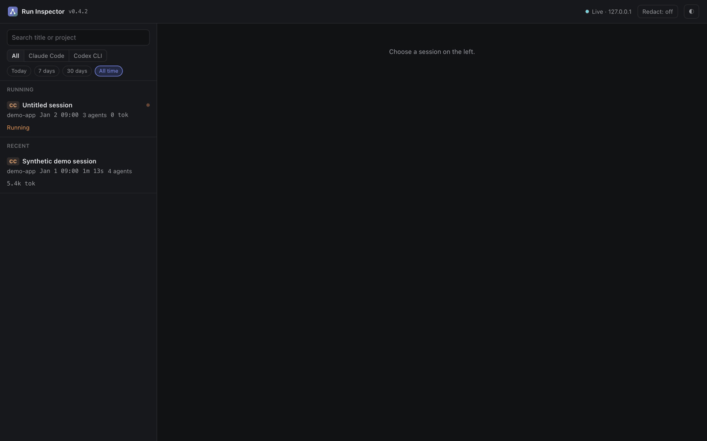

[English](README.md) | 한국어

# agent-run-inspector

Claude Code 와 Codex CLI 의 에이전트 실행을 로컬 브라우저에서 실시간으로 보는 읽기 전용 도구입니다. 누가 누구를 불렀는지, 호출마다 비용이 얼마인지, 어디서 실패했는지 한눈에 봅니다.



## What you see

- **세션 목록**: 실행 중인 세션이 위, 최근 세션이 아래에 나옵니다. 도구(Claude Code, Codex CLI)·기간으로 거르거나 제목·프로젝트로 찾습니다. 에이전트 팀의 팀원(teammate)은 따로 나오지 않고, 자신을 띄운 실행 안에 묶여 보입니다.
- **그래프**: orchestrator 부터 에이전트마다 카드 하나. 카드에는 최근 호출, 상태, 비용, 시간, 호출 수가 보입니다. 카드를 누르면 그 에이전트만의 합계가 나오고, "Hide finished agents" 로 아직 일하는 에이전트만 남길 수 있습니다.
- **타임라인**: 모든 에이전트와 호출을 한 시간 축에 놓고 턴·컨텍스트 압축 시점도 표시합니다. 호출을 열면 자세한 내용이 보입니다.
- **합계**: 실행 전체나 고른 에이전트의 시간, 비용, 토큰, 모델 호출, 도구 호출, 오류.
- **실시간**: 기록에 새 줄이 생기면 새로 고침 없이 1초 안팎에 화면에 반영됩니다.

## Install and run

이 도구들이 이미 디스크에 남기는 실행 기록을 읽습니다. 에이전트 쪽에는 아무것도 설치하지 않습니다(훅·프록시 없음). Node 22 이상, 런타임 의존성 없음, 빌드 단계 없음.

```sh
npx github:th-yong/agent-run-inspector
```

`http://127.0.0.1:<port>/?t=<token>` 을 출력하고 엽니다. `npm i -g github:th-yong/agent-run-inspector` 뒤에는 짧은 이름 `ari` 도 쓸 수 있습니다.

### Run from a local clone

```sh
git clone https://github.com/th-yong/agent-run-inspector.git
cd agent-run-inspector
node bin/cli.js
# 또는: npm link 후 ari 실행
```

## Options

| 옵션 | 하는 일 |
|---|---|
| `--port <n>` | 들을 포트 (기본: 비어 있는 포트 자동) |
| `--open[=<where>]` | 주소 열기: `auto`(기본; Orca 안이면 Orca 탭, 아니면 기본 브라우저), `orca`, `browser`, `none` |
| `--no-open` | 주소만 출력 (`--open=none` 과 같음) |
| `--root <dir>` | Claude Code projects 폴더 추가 (반복 가능) |
| `--codex-root <dir>` | Codex sessions 폴더 추가 (반복 가능) |
| `--source <name>` | `claude`, `codex`, `all` (기본: `all`) |
| `--since <age>` | 이 기간보다 새 실행만, 예: `24h`, `7d`, `30d` |
| `--redact[=strict]` | 메시지 본문 숨김 (`strict`: 더 많이 숨김) |
| `--prices <file>` | 내장 단가표를 덮어쓰는 단가표 |
| `--session <id>` | 이 세션을 바로 열기 |
| `-v, --version` | 버전 출력 |
| `-h, --help` | 도움말 출력 |
| `ari roots list` | 쓰고 있는 기록 폴더 보기 |
| `ari roots add <dir>` | Claude Code 폴더 기억 (Codex 는 `--codex`) |
| `ari roots remove <dir>` | 기억한 폴더 잊기 |

## Finding your logs

| 도구 | 기본 폴더 |
|---|---|
| Claude Code | `$CLAUDE_CONFIG_DIR/projects` 가 있으면 그것, 없으면 `~/.claude/projects` |
| Codex CLI | `$CODEX_HOME/sessions` 가 있으면 그것, 없으면 `~/.codex/sessions` |

기록이 다른 곳에 있으면(예: 다른 앱의 프로필별 폴더) 한 번만 더해 두세요. `~/.config/agent-run-inspector/config.json` 에 기억됩니다.

```sh
ari roots add ~/some/profile/projects
ari roots add --codex ~/some/codex/sessions
```

## Opening inside Orca

Orca 안에서는 주소가 Orca 브라우저 새 탭으로 열립니다(`orca tab create`). 실패하거나 Orca 밖이면 기본 브라우저로 엽니다. `--open=none` 이나 `--no-open` 은 주소만 출력합니다.

## Security

실행 기록에는 고객 데이터나 비밀이 있을 수 있으므로, 화면에 보이는 것 말고는 이 컴퓨터 밖으로 나가지 않습니다.

- 서버는 `127.0.0.1` 에서만 듣습니다.
- 실행마다 무작위 토큰을 만듭니다. 첫 주소에 한 번 담기고, 이후 HttpOnly·SameSite=Strict 쿠키로 바뀌며 주소창에서 사라집니다. 쿠키 없는 요청은 401 입니다. Host·Origin 헤더도 검사합니다.
- 외부 요청 0: 스크립트·아이콘은 패키지 안에 있고 글꼴은 시스템 글꼴을 씁니다. CDN·웹 글꼴·텔레메트리·업데이트 확인 없음.
- 읽기 전용: 기록 파일을 쓰거나 지우지 않습니다. 화면은 파일 경로를 보내지 않고, 파일은 불투명 id 로만 찾으며 알려진 기록 폴더 안이어야 합니다.

### Redaction

`--redact`(basic)는 메시지 본문, 도구 입력 값, 과제, 명령, 오류 문구를 숨기고 길이와 키 이름만 남깁니다. `--redact=strict` 는 세션 제목, 프로젝트 이름, 브랜치, 폴더 경로까지 숨깁니다(화면 공유용). 정하는 쪽은 서버입니다. 위쪽 막대의 토글은 단계를 올릴 수만 있고 서버가 시작한 단계 아래로는 못 내립니다.

## Cost

비용은 청구서가 아닌 추정치입니다. 모델 호출마다 내장 `prices.json`(100만 토큰당 USD, 기준일 `asOf` 2026-11-13, 모델마다 출처 주소: Anthropic·OpenAI 공개 가격 페이지)으로 값을 매기고, 모르는 모델의 호출은 토큰만 보이며 합계에 부분 표시가 붙습니다. Claude Code 실행은 Claude Code 가 직접 기록한 세션 합계("Reported")가 있으면 그것을 씁니다. 단, 팀원 세션이 들어 있는 실행은 그 합계에 팀원 몫이 빠져 있으므로 쓰지 않습니다. `--prices <file>` 로 모델을 덮어쓰거나 더할 수 있고, 내장 표 위에 필드 단위로 합쳐집니다.

## Supported scope

Claude Code(메인 세션, 하위 에이전트, 에이전트 팀의 팀원)와 Codex CLI(0.40 ~ 0.166 롤아웃 파일). 넣지 않는 것: 에이전트 조작, 훅·프록시, 원격 접속·계정, Cursor·Gemini CLI 같은 다른 도구, 본문 검색, 내보내기, 알림.

### Known limits

- Codex 하위 에이전트는 시간으로 부모와 잇기 때문에, 여러 개가 동시에 시작하면 연결이 추정입니다.
- 하위 에이전트의 하위 에이전트(손자)는 본 기록에서 드물고, 다음 줄의 일반 카드로 그립니다.
- Claude Code 팀원은 기록 폴더가 리더와 같거나 그 아래일 때만(예: 리더 프로젝트의 `.claude/worktrees/...` 워크트리) 리더에 묶입니다. 그 밖이면 별도 세션으로 나옵니다. 팀원이 띄운 하위 에이전트는 아직 그리지 않습니다.
- 작업 폴더가 다른 실행(예: Orca 워크트리마다 하나씩)은 각각 별도 세션으로 나옵니다.
- 비용은 아는 모델이어야 계산되고, 모르는 모델은 토큰만 보입니다.

## Third-party assets

브랜드 아이콘은 simple-icons 15.22.0(CC0-1.0)에서 가져와 의존성 없이 인라인했고, 호출이 어느 제공사·서비스의 것인지 표시하는 데만 씁니다. 브랜드 이름과 로고의 상표는 각 회사 소유이며, 이 프로젝트는 그 회사들과 제휴하거나 보증받지 않았습니다. 로고는 각 회사 고유색 그대로 씁니다. 가이드라인이 이런 사용을 허용하지 않는 회사(OpenAI, Google, Figma, Slack, Python, Docker, PostgreSQL, Linear, Vercel, Atlassian)의 로고는 그리지 않고 중립 기호로 대신합니다. 출처 표기(Git 로고 Jason Long, CC BY 3.0 / Yarn 로고 CC BY 4.0), 상표 고지, 회사별 가이드라인 검토 결과는 [THIRD_PARTY_NOTICES.md](THIRD_PARTY_NOTICES.md) 에 있습니다.

## License

코드는 [MIT License](LICENSE) 를 따릅니다. 이 라이선스는 다른 회사의 브랜드 이름과 로고에는 적용되지 않습니다.
