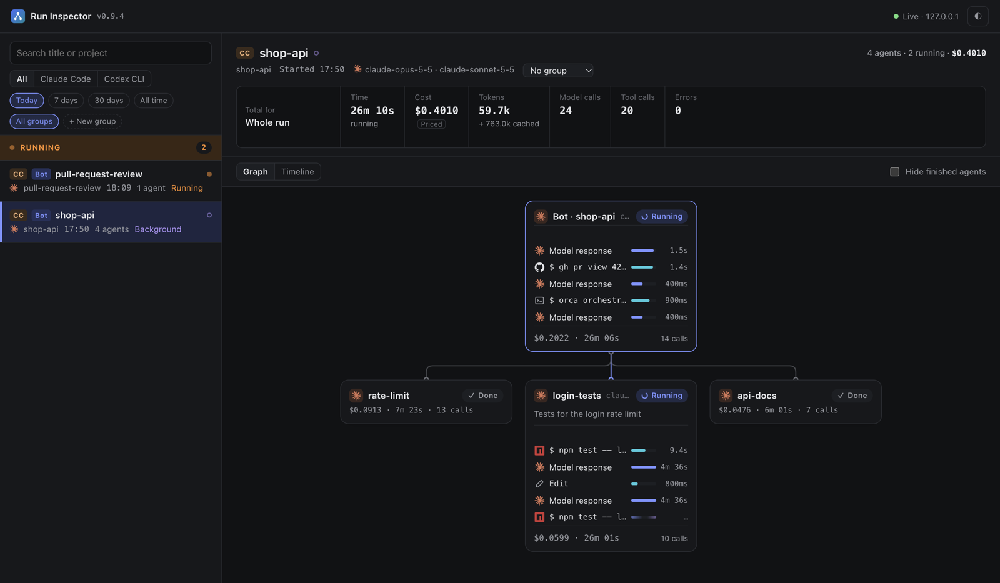
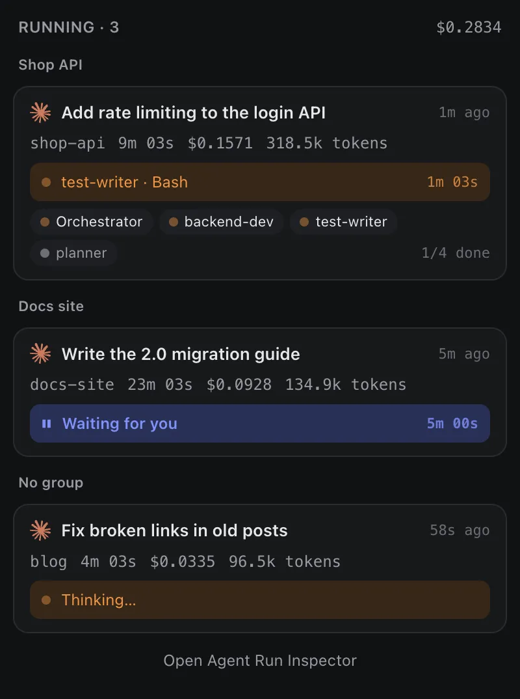

English | [한국어](README.ko.md)

# agent-run-inspector

[](https://github.com/th-yong/agent-run-inspector/actions/workflows/ci.yml)
[](LICENSE)
[](https://www.npmjs.com/package/agent-run-inspector)
[](package.json)

A local, read-only inspector for Claude Code and Codex CLI agent runs, Orca bots included: see who called whom, what each call cost and where it failed, live, in your browser.


## Get started

It reads the run logs Claude Code and Codex CLI already write to disk. Nothing is installed into the agents (no hooks, no proxy). You need Node 22 or newer (check with `node -v`). On a Mac without it, install it with `brew install node` ([Homebrew](https://brew.sh)) or the installer from [nodejs.org](https://nodejs.org). If `npm i -g` fails with `EACCES`, your Node came from the nodejs.org installer: use Homebrew's Node or [nvm](https://github.com/nvm-sh/nvm) rather than `sudo`.

### On a Mac: use it as an app

```sh
npm i -g agent-run-inspector
ari service install
```

That's all. **Agent Run Inspector** opens in its own window and stays in your Dock, and it starts with your Mac, so you never need the terminal again. It also puts a menu bar item up that counts running runs. Details: [The Mac app](#the-mac-app).

### Anywhere: try it once

```sh
npx agent-run-inspector
```

It opens the inspector in your browser and runs until you press Ctrl+C.

## What you see

- **Session list**: running sessions on top, then recent ones (fold them with a click). Filter by tool (Claude Code, Codex CLI) and period (Today by default), or search by title or project. **Groups**: make one with "+ New group", then drag sessions onto it or right-click a session; pick a group to see only its sessions. Groups are kept in `~/.config/agent-run-inspector/groups.json`. Agent-team teammates and [Orca workers](#orca-bots) are folded into the run that started them instead of being listed on their own.
- **Graph**: one card per agent, from the orchestrator down. Each card shows its latest calls, status, cost, time and call count. Click a card to total that agent; "Hide finished agents" keeps only the ones still working.
- **Timeline**: every agent and call on one time axis, with turns and context compactions. Open a call to see its details.
- **Totals**: time, cost, tokens, model calls, tool calls and errors for the whole run or the selected agent.
- **Live**: new lines in the logs show up within about a second, with no reload.

## Orca bots

Orca bots are long-lived Claude Code sessions that start workers in their own worktrees and hand work to other bots. The inspector shows a bot and its workers as one run:

- **Bot badge**: a bot's session (run from `~/.orca/bots/<name>`) is marked with a gold **Bot** badge in the session list and named after the bot, and its top card in the graph is framed in gold and reads "Bot · <name>" instead of Orchestrator.
- **Workers under their bot**: each worker started with `orca orchestration worker-start` is a card under the bot, named by `--name` (or its workspace folder) with its `--task-title` as the task, and shows its own calls, cost and status. Its session is not listed on its own.
- **One total**: the run's time, cost and tokens include the workers. The bot keeps running while a worker does.



A worker is joined to its bot by the task id in `worker-start`'s result, so a session that only quotes the ids links nothing. Any session that starts workers this way, not only a bot, gets them folded in. Not drawn yet: Codex workers, messages between bots, and a bot's wake-ups as separate runs.

## Options

| Option | What it does |
|---|---|
| `--port <n>` | Port to listen on (default: random free port) |
| `--open[=<where>]` | Open the address: `auto` (default; Orca tab inside Orca, else default browser), `orca`, `browser` or `none` |
| `--no-open` | Only print the address (same as `--open=none`) |
| `--root <dir>` | Extra Claude Code projects folder (repeatable) |
| `--codex-root <dir>` | Extra Codex sessions folder (repeatable) |
| `--source <name>` | `claude`, `codex` or `all` (default: `all`) |
| `--since <age>` | Only runs newer than this, e.g. `24h`, `7d`, `30d` |
| `--redact[=strict]` | Hide message bodies (`strict`: hide more) |
| `--prices <file>` | Price table that overrides the built-in one |
| `--session <id>` | Open this session directly |
| `--no-update-check` | Do not check npm for a newer version |
| `-v, --version` | Print the version |
| `-h, --help` | Show the help |
| `ari roots list` | Show the log folders in use |
| `ari roots add <dir>` | Remember a Claude Code folder (`--codex` for Codex) |
| `ari roots remove <dir>` | Forget a remembered folder |
| `ari service install` | macOS: keep it running from login (see below) |
| `ari service uninstall` | Stop and remove the service |
| `--no-dock` | With `service install`: do not add the app to the Dock |
| `ari open` | Open the running service in the browser |

## Finding your logs

| Tool | Default folder |
|---|---|
| Claude Code | `$CLAUDE_CONFIG_DIR/projects` if set, else `~/.claude/projects` |
| Codex CLI | `$CODEX_HOME/sessions` if set, else `~/.codex/sessions` |

If your logs live elsewhere, for example in a per-profile folder of another app, add the folder once and it is remembered in `~/.config/agent-run-inspector/config.json`:

```sh
ari roots add ~/some/profile/projects
ari roots add --codex ~/some/codex/sessions
```

## Opening inside Orca

Inside Orca the address opens as a new Orca browser tab (`orca tab create`). If that fails, or outside Orca, it falls back to the default browser. `--open=none` or `--no-open` only prints the address.

## The Mac app

`ari service install` sets up three things:

- **A background service** that starts at login on `http://127.0.0.1:7317/` (`--port <n>` to change), so the inspector is always ready.
- **Agent Run Inspector.app** in `~/Applications`, added to the Dock (`--no-dock` to skip): its own window and Launchpad entry, signed in at every launch. It also puts an item in the menu bar (see [The menu bar](#the-menu-bar)). At login the app starts with only the menu bar item, and the window opens from the menu or the Dock. It is built on your Mac with the built-in `osacompile`, so there is nothing to download and no developer signing. If that fails, open the address in Chrome or Edge and choose Install instead.
- **A sign-in that lasts a year** for that address, so a bookmark works too. If a browser tab says "Signed out", run `ari open`.

**Updates**: the app checks the latest GitHub release every hour. When there is a newer one and npm already serves it, the menu bar panel shows an "Update to …" button and the right-click menu an "Update to …" item (otherwise "Check for Updates…"); the page header shows an "Update …" badge too, which works the same in the app window. Click one and the app installs the new version and reopens (about a minute; a failed install is tried twice more, 30 seconds apart). If that fails, it shows the commands to run: install the package again and run `ari service install` again, which restarts the service and the app on the new code. `ari service uninstall` removes the service, the app, its Dock icon and its login item. The log is `~/Library/Logs/agent-run-inspector.log`.

### The menu bar



The app's mark sits in the menu bar with the number of sessions running now, so you can follow long runs while you work in other apps. The picture shows the three states a session can be in: in a tool call, waiting for you, and thinking.

- **Click** for a panel of the running sessions, grouped by your [groups](#what-you-see). The top line shows how many are running and what they have cost so far.
- Each session shows its title, project, time, cost, tokens and failed calls. A highlighted line says what it is doing now: the tool and how long it has been in it, "Thinking…" between calls, or **Waiting for you** when it asks you something. When a run has sub-agents, they are listed with a dot each (orange: working, grey: done) and how many are done.
- **Click a session** to open it in the app window. "Open Agent Run Inspector" at the bottom opens the window as it was.
- **Right-click** for a plain menu: the running sessions, Open, Check for Updates and Quit.
- The panel closes when you click anywhere else, and it does not bring the app window in front of what you are working on.
- On a Mac with a notch, the item can be hidden when the menu bar is full. Hold ⌘ and drag menu bar items to make room, or quit an app whose item you don't need.


## Security

Run logs can hold customer data and secrets, so nothing leaves your machine except what you see on screen.

- The server listens on `127.0.0.1` only.
- Each run makes a random token. The first address carries it once, then it becomes an HttpOnly, SameSite=Strict cookie and disappears from the address bar. Requests without the cookie get 401, except the web app manifest and its icons (browsers fetch them without cookies; they hold nothing about your logs). Host and Origin headers are checked.
- The service (`ari service install`) instead keeps one token in `~/.config/agent-run-inspector/service.json` (readable by you only), and its cookie lasts a year. The token is never in the LaunchAgent file, the process arguments or the log. `ari service uninstall` deletes it; installing again keeps it.
- Outside requests are update checks only. The CLI asks GitHub (`api.github.com`, the latest release of this project) once an hour and prints a line in the terminal if there is a newer version. The Mac app asks the same every hour, and before it offers a newer version it checks that npm (`registry.npmjs.org`) has that version's package. Neither sends anything about you or your logs. Turn the CLI check off with `--no-update-check` or `ARI_NO_UPDATE_CHECK=1` (also off when `CI` or `NO_UPDATE_NOTIFIER` is set). Scripts and icons ship in the package and text uses the system's own fonts: no CDN, web fonts or telemetry.
- Updates install only when you press Update in the Mac app: it runs `npm i -g agent-run-inspector` (the newest release, not unreleased work) and `ari service install`, and writes what happened to `~/Library/Logs/agent-run-inspector-update.log`.
- Found a security problem? See [SECURITY.md](SECURITY.md).
- Read-only: log files are never written or deleted. The screen never sends a file path; files are found by opaque ids and must stay inside the known log folders.

### Redaction

`--redact` (basic) hides message bodies, tool input values, tasks, commands and error text, and keeps only lengths and key names. `--redact=strict` also hides session titles, project names, branches and folder paths, for screen sharing. Use it when someone else sees your screen: a screen share, a recording or a screenshot.

## Cost

Costs are estimates, not bills. Each model call is priced from the built-in `prices.json` (USD per 1M tokens, with an `asOf` date of 2026-11-13 and a source URL per model: the Anthropic and OpenAI public pricing pages); a call on an unknown model shows tokens only and the total is marked partial. For a Claude Code run, the session total that Claude Code itself recorded ("Reported") replaces the sum when it is there, except when teammate or Orca worker sessions are part of the run, since that total leaves them out. Override or add models with `--prices <file>`, which is merged field by field over the built-in table.

## Supported scope

Claude Code (main sessions, sub-agents, agent-team teammates, Orca bots and their workers) and Codex CLI (rollout files from 0.40 to 0.166). Not included: controlling agents, hooks or proxies, remote access or accounts, other tools such as Cursor or Gemini CLI, full-text search, exporting, and alerts.

### Known limits

- Codex sub-agents are linked to their parent by timing, so the link is an estimate when several start at once.
- Sub-agents of sub-agents are rare in the logs we have seen and are drawn as plain cards on the next row.
- A Claude Code teammate is joined to its lead only when its log folder is the lead's own or one below it (for example a `.claude/worktrees/...` worktree of the lead's project). Otherwise it is listed as a session of its own. Sub-agents started by a teammate are not drawn yet.
- Every run in its own working folder (for example one Orca worktree each) is listed as its own session.
- Cost needs a known model; unknown models show tokens only.

## Development

```sh
git clone https://github.com/th-yong/agent-run-inspector.git
cd agent-run-inspector
node bin/cli.js        # or: npm link, then run ari
npm test && npm run lint
```

Without the app, `ari` prints `http://127.0.0.1:<port>/?t=<token>` and opens it; the token signs the browser in for that run only.

## Third-party assets

Brand icons come from simple-icons 15.22.0 (CC0-1.0), inlined without a dependency, and only mark which provider or service a call belongs to. Brand names and logos are trademarks of their owners; this project is not affiliated with or endorsed by them. Logos keep their owners' colors. Logos whose owners' guidelines do not allow this use (OpenAI, Google, Figma, Slack, Python, Docker, PostgreSQL, Linear, Vercel, Atlassian) are not drawn; a neutral symbol stands in. Credits (Git logo by Jason Long, CC BY 3.0; Yarn logo, CC BY 4.0), trademark notices and the per-brand guideline review are in [THIRD_PARTY_NOTICES.md](THIRD_PARTY_NOTICES.md).

## License

The code is under the [MIT License](LICENSE). The license does not cover the third-party brand names and logos.

---

If this saved you some digging, a ⭐ on [GitHub](https://github.com/th-yong/agent-run-inspector) is the whole fee.
